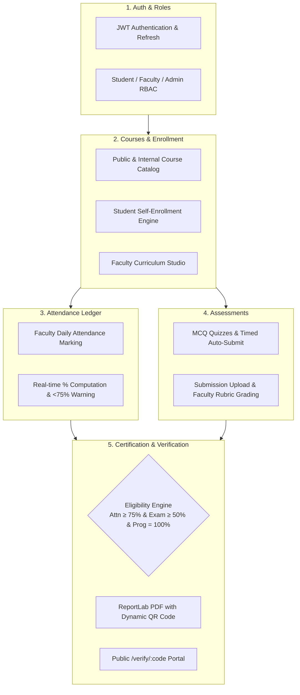

# EduSphere LMS — Modern 5-Pillar Student Learning Management System

EduSphere LMS is an enterprise-grade Student Learning Management System engineered around **5 core functional pillars** and **role-based intelligence dashboards**. Built with **FastAPI**, **SQLAlchemy**, and **React + TypeScript + Vite**.

---

## 🏛️ The 5 Pillars of EduSphere LMS



### **Pillar 1: Authentication & Role-Based Access Control**
- Secure password hashing using PBKDF2-SHA256 (100,000 iterations).
- JWT Bearer tokens with automatic client-side token refresh.
- Role-gated endpoints and interfaces: **STUDENT**, **FACULTY**, **ADMIN**.
- Public student registration & faculty secret key-gated onboarding.

### **Pillar 2: Course Catalog & Self-Enrollment**
- Course catalog with department filtering and prerequisite tracking.
- Student self-enrollment (`POST /api/courses/{id}/self-enroll`): idempotent, updates student workspace instantly.
- Faculty Curriculum CMS: create courses, submit for approval, manage structured modules and video lessons.
- Course roster view for faculty and administrators.

### **Pillar 3: Attendance Tracking & Warnings**
- Faculty attendance manager: mark sessions by date (Present / Absent / Late) with one-click "Mark All Present".
- Student attendance ledger: per-course attendance rate computation.
- Automatic visual warnings (red badge and notification) when attendance falls below 75%.

### **Pillar 4: Assessments (Quizzes & Assignments)**
- **MCQ Quizzes**:
  - Faculty quiz creator: question prompts, 4 options, correct answer keys, pass percentage, and time limit.
  - Student timed quiz runner: countdown timer with automatic submission on timeout and backend-calculated scores.
- **Assignments**:
  - Student file submission uploader with secure file handling.
  - Faculty single-modal rubric grading interface with score validation ($0 \le \text{marks} \le \text{max\_marks}$).

### **Pillar 5: Automated Certification & Public Verification**
- **Strict Verification Rule**: A certificate is issued if and only if:
  $$\text{Attendance} \ge 75\% \quad\land\quad \text{Average Assessment Score} \ge 50\% \quad\land\quad \text{Course Progress} = 100\%$$
- Dynamic vector PDF generation via ReportLab with embedded QR code.
- Public certificate verification portal at `/verify/<code>` accessible without login.

### **Role-Tailored Operational Dashboards**
- **Student Dashboard**: Active enrolled courses, overall attendance rate, assessment progress, and certificate eligibility.
- **Faculty Dashboard**: Assigned courses, enrolled students count, pending assignment grading queue, and attendance sessions.
- **Admin Dashboard**: System user registry, course directory, campus-wide attendance percentage, certificates count, and audit trails.

---

## 🚀 Quickstart & Local Setup

### Prerequisites
- Python 3.10+
- Node.js 18+ and npm
- PostgreSQL (optional — SQLite is used by default for zero-config development)

### 1. Backend Setup
```bash
# Navigate to the server directory
cd server

# Create and activate a Python virtual environment
python -m venv venv
# On Windows:
.\venv\Scripts\activate
# On macOS/Linux:
source venv/bin/activate

# Install dependencies
pip install -r requirements.txt

# Configure environment
cp .env.example .env

# Seed initial demo dataset (Idempotent: 1 admin, 2 faculty, 10 students, 3 courses, attendance, quizzes, submissions)
python seed_demo.py

# Start the FastAPI backend
uvicorn main:app --reload --port 5000
```
- API Docs: [http://localhost:5000/api/docs](http://localhost:5000/api/docs)

---

### 2. Frontend Setup
```bash
# In the root workspace directory:
npm install

# Start Vite development server
npm run dev
```
- Frontend Web App: [http://localhost:5173](http://localhost:5173)

---

## 🔑 Initial Bootstrap Admin & Account Setup

EduSphere starts with an empty database. The initial administrator account is created securely via the CLI:

```bash
# Bootstrap the first administrator (prompts for password, min 12 characters)
cd server
python -m app.cli create-admin --email admin@institution.edu --name "System Administrator"
```

> **Security Guarantee:** No default administrative credentials exist in code, configuration, or containers.

### Optional Demo Seeding (Demo Environment Only)
To populate demo curriculum and users for non-production demonstration:
```bash
# Refuses to run unless ENV=demo and the database name ends with '_demo'
ENV=demo python -m app.cli seed-demo
```

---

## 🧪 Running Automated Tests

Run the complete backend test suite covering security, authentication, self-enrollment, attendance percentage logic, and certificate evaluation rules:

```bash
cd server
python -m pytest tests/ -v
```

```
====================== 26 passed in 10.10s ======================
```

---

## 🌐 Production Deployment

### Option A: Render (Backend + PostgreSQL)
1. In [Render Dashboard](https://dashboard.render.com/), create a new **PostgreSQL Database** (`edusphere-db`).
2. Create a new **Web Service** pointing to this repository.
   - **Environment**: `Docker` or `Python 3`
   - **Build Command**: `pip install -r server/requirements.txt`
   - **Start Command**: `gunicorn server.main:app -w 2 -k uvicorn.workers.UvicornWorker -b 0.0.0.0:$PORT`
3. Add Environment Variables:
   - `DATABASE_URL`: *(Your Render PostgreSQL Connection String)*
   - `JWT_SECRET_KEY`: *(Generate a secure 64-character string)*
   - `ENVIRONMENT`: `production`
   - `FRONTEND_URL`: `https://your-frontend.vercel.app`
4. Run the demo seeder once via the Render Shell:
   ```bash
   python server/seed_demo.py
   ```

### Option B: Vercel / Netlify (Frontend)
1. Import the repository in [Vercel](https://vercel.com/) or [Netlify](https://www.netlify.com/).
2. Settings:
   - **Framework Preset**: `Vite`
   - **Build Command**: `npm run build`
   - **Output Directory**: `dist`
3. Set Environment Variable:
   - `VITE_API_URL`: `https://your-render-backend.onrender.com`
4. The included `vercel.json` and `netlify.toml` automatically handle SPA routing fallbacks (`/* -> /index.html`).

---

## 📸 Screenshots

Walkthrough screenshots are organized in [`screenshots/`](file:///c:/EduSphere/screenshots/README.md):
- Multi-role login & session recovery
- Real-time role dashboards (Student / Faculty / Admin)
- Self-enrollment catalog
- Faculty attendance marking & student attendance warning
- Timed MCQ quiz engine & single-modal assignment grading
- QR-coded certificate generation & verification portal
