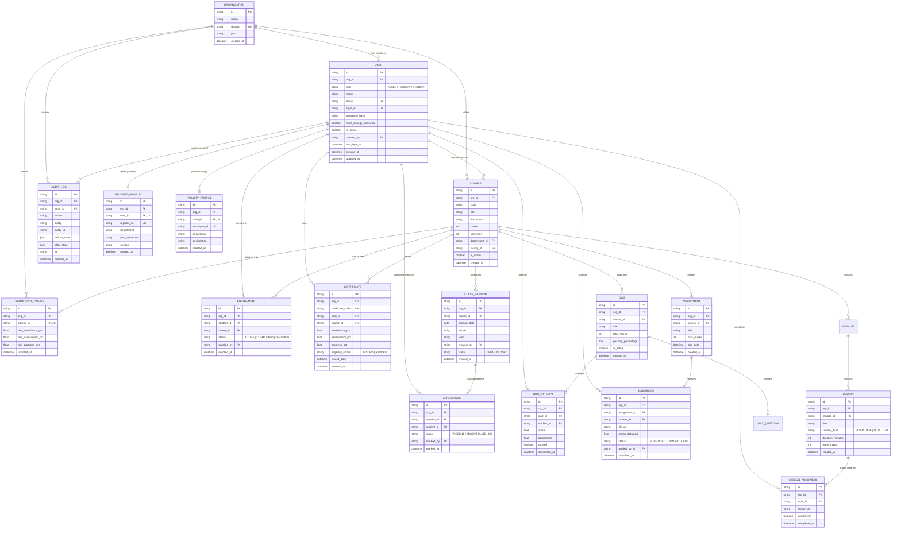

# EduSphere LMS — Database Schema & Data Model Specification

## 1. Overview & Multi-Tenancy Design
EduSphere is a multi-tenant institutional Learning Management System. Every entity in the system belongs to an **Organization** (`org_id`). 
All database queries must be filtered by the authenticated user's `org_id` derived directly from their verified JWT token.

---

## 2. Entity-Relationship (ER) Diagram

---

## 3. Detailed Entity Schema & Constraints

### 3.1 Organization (`organizations`)
- `id`: `String(36)`, Primary Key.
- `name`: `String(100)`, Not Null.
- `domain`: `String(100)`, Unique, Nullable.
- `plan`: `Enum('FREE', 'PRO', 'ENTERPRISE')`, Default `'FREE'`.
- `created_at`: `DateTime`, Default UTC.

### 3.2 User (`users`)
- `id`: `String(36)`, Primary Key.
- `org_id`: `String(36)`, Foreign Key → `organizations.id`, Not Null, Indexed.
- `role`: `Enum('ADMIN', 'FACULTY', 'STUDENT')`, Not Null, Default `'STUDENT'`.
- `name`: `String(255)`, Not Null.
- `email`: `String(255)`, Unique, Not Null, Indexed.
- `login_id`: `String(100)`, Unique, Nullable, Indexed (can hold Roll No / Employee ID / handle).
- `password_hash`: `String(255)`, Not Null (PBKDF2-SHA256).
- `must_change_password`: `Boolean`, Default `False`.
- `is_active`: `Boolean`, Default `True`.
- `created_by`: `String(36)`, Foreign Key → `users.id`, Nullable.
- `last_login_at`: `DateTime`, Nullable.
- `created_at`: `DateTime`, Default UTC.
- `updated_at`: `DateTime`, Default UTC.

### 3.3 StudentProfile (`student_profiles`)
- `id`: `String(36)`, Primary Key.
- `org_id`: `String(36)`, Foreign Key → `organizations.id`, Not Null, Indexed.
- `user_id`: `String(36)`, Foreign Key → `users.id`, Unique, Not Null, Indexed.
- `register_no`: `String(50)`, Nullable, Indexed.
- `department`: `String(100)`, Nullable.
- `year_semester`: `String(50)`, Nullable.
- `section`: `String(20)`, Nullable.
- `created_at`: `DateTime`, Default UTC.
- `updated_at`: `DateTime`, Default UTC.
- **Constraints**: `UNIQUE(org_id, register_no)`.

### 3.4 FacultyProfile (`faculty_profiles`)
- `id`: `String(36)`, Primary Key.
- `org_id`: `String(36)`, Foreign Key → `organizations.id`, Not Null, Indexed.
- `user_id`: `String(36)`, Foreign Key → `users.id`, Unique, Not Null, Indexed.
- `employee_id`: `String(50)`, Nullable, Indexed.
- `department`: `String(100)`, Nullable.
- `designation`: `String(100)`, Nullable.
- `created_at`: `DateTime`, Default UTC.
- `updated_at`: `DateTime`, Default UTC.
- **Constraints**: `UNIQUE(org_id, employee_id)`.

### 3.5 Course (`courses`)
- `id`: `String(36)`, Primary Key.
- `org_id`: `String(36)`, Foreign Key → `organizations.id`, Not Null, Indexed.
- `code`: `String(20)`, Not Null, Indexed.
- `title`: `String(255)`, Not Null.
- `description`: `Text`, Nullable.
- `credits`: `Integer`, Default 3.
- `semester`: `Integer`, Default 1.
- `department_id`: `String(36)`, Foreign Key → `departments.id`, Nullable.
- `faculty_id`: `String(36)`, Foreign Key → `users.id`, Nullable, Indexed.
- `is_active`: `Boolean`, Default `True`.
- `created_at`: `DateTime`, Default UTC.
- **Constraints**: `UNIQUE(org_id, code)`.

### 3.6 Enrollment (`enrollments`)
- `id`: `String(36)`, Primary Key.
- `org_id`: `String(36)`, Foreign Key → `organizations.id`, Not Null, Indexed.
- `student_id`: `String(36)`, Foreign Key → `users.id`, Not Null, Indexed.
- `course_id`: `String(36)`, Foreign Key → `courses.id`, Not Null, Indexed.
- `status`: `Enum('ACTIVE', 'COMPLETED', 'DROPPED')`, Default `'ACTIVE'`.
- `enrolled_by`: `String(36)`, Foreign Key → `users.id`, Nullable.
- `enrolled_at`: `DateTime`, Default UTC.
- **Constraints**: `UNIQUE(student_id, course_id)`.

### 3.7 ClassSession (`attendance_sessions` / `class_sessions`)
- `id`: `String(36)`, Primary Key.
- `org_id`: `String(36)`, Foreign Key → `organizations.id`, Not Null, Indexed.
- `course_id`: `String(36)`, Foreign Key → `courses.id`, Not Null, Indexed.
- `session_date`: `Date`, Not Null, Indexed.
- `period`: `String(50)`, Nullable (e.g. "09:00 - 10:00").
- `topic`: `String(255)`, Nullable.
- `created_by`: `String(36)`, Foreign Key → `users.id`, Not Null.
- `status`: `Enum('OPEN', 'CLOSED')`, Default `'OPEN'`.
- `created_at`: `DateTime`, Default UTC.

### 3.8 Attendance (`attendance_logs`)
- `id`: `String(36)`, Primary Key.
- `org_id`: `String(36)`, Foreign Key → `organizations.id`, Not Null, Indexed.
- `session_id`: `String(36)`, Foreign Key → `attendance_sessions.id`, Not Null, Indexed.
- `student_id`: `String(36)`, Foreign Key → `users.id`, Not Null, Indexed.
- `status`: `Enum('PRESENT', 'ABSENT', 'LATE', 'OD')`, Default `'PRESENT'`.
- `marked_by`: `String(36)`, Foreign Key → `users.id`, Nullable.
- `marked_at`: `DateTime`, Default UTC.
- **Constraints**: `UNIQUE(session_id, student_id)`.

### 3.9 Assessment (Quiz & Assignment), Attempts & Scores
- **Quiz (`quizzes`)**:
  - `id`: PK, `org_id`: FK, `course_id`: FK, `title`: String, `total_marks`: Int, `passing_percentage`: Float, `is_active`: Bool.
- **QuizAttempt (`quiz_attempts`)**:
  - `id`: PK, `org_id`: FK, `quiz_id`: FK, `student_id`: FK, `score`: Float, `percentage`: Float, `passed`: Bool, `completed_at`: DateTime.
- **Assignment (`assignments`)**:
  - `id`: PK, `org_id`: FK, `course_id`: FK, `title`: String, `max_marks`: Int, `due_date`: DateTime.
- **Submission (`submissions`)**:
  - `id`: PK, `org_id`: FK, `assignment_id`: FK, `student_id`: FK, `file_url`: String, `marks_obtained`: Float, `status`: Enum, `graded_by_id`: FK.
  - **Constraints**: `UNIQUE(assignment_id, student_id)`.

### 3.10 Lesson & LessonProgress (`lessons`, `lesson_progress`)
- **Lesson (`lessons`)**:
  - `id`: PK, `org_id`: FK, `module_id`: FK, `title`: String, `content_type`: Enum, `duration_minutes`: Int, `order_index`: Int.
- **LessonProgress (`lesson_progress`)**:
  - `id`: PK, `org_id`: FK, `user_id`: FK (`student_id`), `lesson_id`: String, `completed`: Bool, `completed_at`: DateTime.
  - **Constraints**: `UNIQUE(user_id, lesson_id)`.

### 3.11 CertificatePolicy & Certificate
- **CertificatePolicy (`certificate_policies`)**:
  - `id`: `String(36)`, Primary Key.
  - `org_id`: `String(36)`, Foreign Key → `organizations.id`, Not Null, Indexed.
  - `course_id`: `String(36)`, Foreign Key → `courses.id`, Not Null, Indexed.
  - `min_attendance_pct`: `Float`, Default 75.0.
  - `min_assessment_pct`: `Float`, Default 50.0.
  - `min_progress_pct`: `Float`, Default 100.0.
  - `created_at`: `DateTime`, Default UTC.
  - `updated_at`: `DateTime`, Default UTC.
  - **Constraints**: `UNIQUE(course_id)`.
- **Certificate (`certificates`)**:
  - `id`: `String(36)`, Primary Key.
  - `org_id`: `String(36)`, Foreign Key → `organizations.id`, Not Null, Indexed.
  - `certificate_code`: `String(100)`, Unique, Not Null, Indexed.
  - `user_id`: `String(36)`, Foreign Key → `users.id`, Not Null, Indexed.
  - `course_id`: `String(36)`, Foreign Key → `courses.id`, Not Null, Indexed.
  - `attendance_pct`: `Float`, Not Null (snapshot at issuance).
  - `assessment_pct`: `Float`, Not Null (snapshot at issuance).
  - `progress_pct`: `Float`, Not Null (snapshot at issuance).
  - `eligibility_status`: `Enum('ISSUED', 'REVOKED')`.
  - `issued_date`: `DateTime`, Default UTC.
  - `revoked_at`: `DateTime`, Nullable.
  - **Constraints**: `UNIQUE(certificate_code)`.

### 3.12 AuditLog (`audit_logs`)
- `id`: `String(36)`, Primary Key.
- `org_id`: `String(36)`, Foreign Key → `organizations.id`, Not Null, Indexed.
- `actor_id`: `String(36)`, Foreign Key → `users.id`, Not Null, Indexed.
- `action`: `String(100)`, Not Null (e.g. `ENROLLMENT_CREATED`, `GRADE_SUBMITTED`, `CERTIFICATE_ISSUED`).
- `entity`: `String(50)`, Not Null (e.g. `COURSE`, `USER`, `ATTENDANCE`, `CERTIFICATE`).
- `entity_id`: `String(36)`, Nullable, Indexed.
- `before_state`: `JSON`, Nullable.
- `after_state`: `JSON`, Nullable.
- `ip`: `String(45)`, Nullable.
- `user_agent`: `Text`, Nullable.
- `created_at`: `DateTime`, Default UTC, Indexed.

---

## 4. Query Isolation & Access Control Rules

1. **Multi-Tenant Filter**:
   Every query must include `WHERE org_id = :current_user_org_id`.
2. **Role Boundaries**:
   - `STUDENT`: Can read own profile, own enrollments, own attendance records, own quiz attempts, own submissions, and own certificates. Cannot view other students' records.
   - `FACULTY`: Can read and manage only courses where `faculty_id = :current_user_id`, class sessions for their courses, attendance logs for their courses, and submissions for their assignments.
   - `ADMIN`: Can manage all entities within their own `org_id`. Cannot access entities belonging to other organizations.
